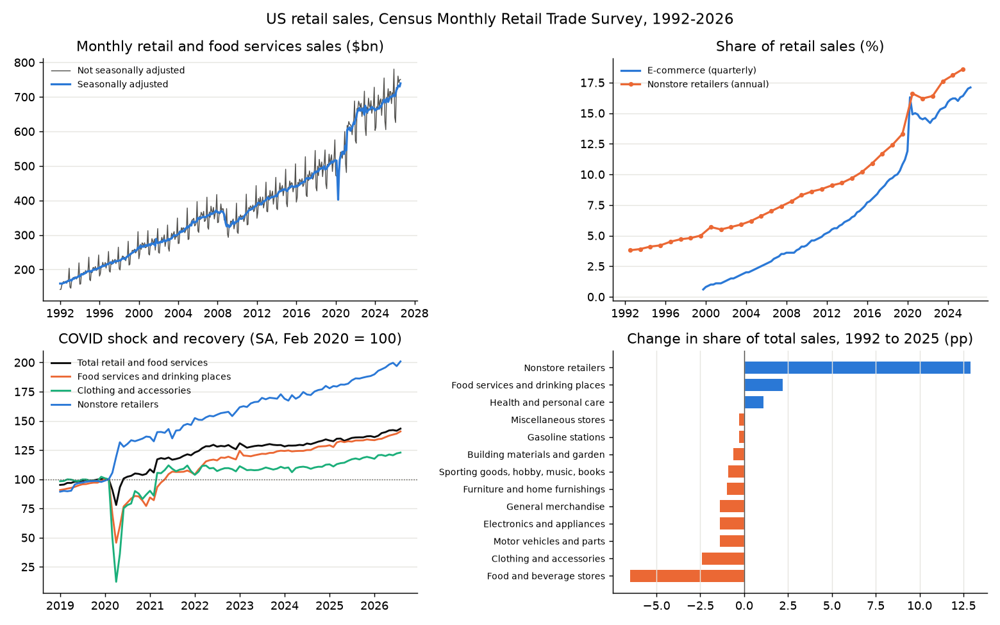
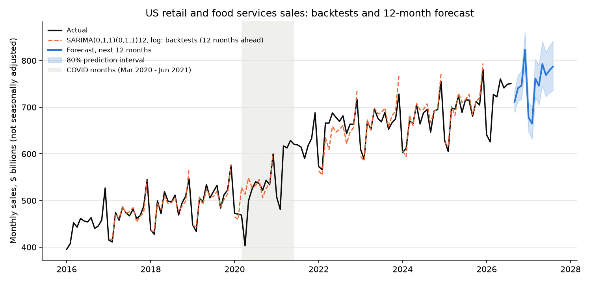

# US Retail Sales: SQL Analytics and a Backtested Forecast (Census MRTS)

This project analyses 34 years of monthly US retail sales, from January 1992 to August 2026. The data is the U.S. Census Bureau's Monthly Retail Trade Survey: 16 series covering total retail and food services and the main NAICS store types, each not seasonally adjusted and seasonally adjusted. It also uses the Census quarterly e-commerce share.

The work has three parts:

1. **SQL (DuckDB).** Nine queries cover growth, category mix shift, the rise of e-commerce, seasonality, December dependence, the COVID shock and recovery, and a data-consistency check.
2. **Interactive dashboard.** A self-contained Plotly page, [`reports/dashboard.html`](reports/dashboard.html). Download it and open it in a browser.
3. **Forecast.** Seven models are compared on a rolling-origin backtest. The best one produces a 12-month forecast with an 80% prediction interval.



## Key findings

All figures are nominal dollars, not adjusted for inflation.

- **Growth.** Retail and food services sales grew from $1.95T in 1992 to $8.35T in 2025, about 4.5% a year.
  - The two breaks are 2009 (-7.5%) and the reopening year 2021 (+18.2%).
  - Since 2023 growth has slowed to 1-3% a year (2025: +3.2%).
- **Online keeps taking share.**
  - E-commerce rose from 0.9% of retail sales in 2000 to 16.3% in 2025, and 17.1% in Q2 2026.
  - COVID pulled the trend forward: the share jumped from 10.6% to 14.5% in 2020, then flattened for two years before rising again.
  - Nonstore retailers (NAICS 454) went from 3.8% to 18.6% of retail sales. Since 2019 their sales have nearly doubled (+92%), against +37% for the total.
- **Category mix.**
  - Nonstore gained 12.9 points of share of total sales between 1992 and 2025.
  - Food and beverage stores lost 6.5 points (from 18.6% to 12.0%), and clothing lost 2.4.
  - Electronics and appliance stores are the only category with lower sales in 2025 than in 2019 (-2%).
- **COVID shock (seasonally adjusted, against February 2020).**
  - Total sales fell 22% in April 2020 and were back above the February level by June 2020.
  - Clothing stores fell 88% and took until March 2021 to recover. Restaurants and bars fell 54% and took until June 2021.
  - Nonstore and grocery never fell below February 2020.
- **Seasonality.**
  - December is 13% above an average month for total sales, while January and February are 11-12% below.
  - Clothing is the most December-dependent category: 13.0% of annual sales, 1.56 times an average month.
  - December is at or below an average month in only three categories:
    - building materials, which peaks in May at +20%
    - gasoline stations, which peaks in July at +9%
    - motor vehicles
- **Forecasting.**
  - The SARIMA "airline" model on log sales had the lowest error, with a mean MAPE of 1.41% on six normal backtest years. That is 54% lower than the seasonal-naive baseline (3.06%).
  - Damped ETS (1.47%) and Holt-Winters (1.52%) were close behind.
  - The next 12 months (Sep 2026 to Aug 2027) are forecast at **$9.00T**, up 4.7% on the last 12 months.

## Forecast backtest

The series is retail and food services total (NAICS 44X72), not seasonally adjusted, in $ millions.

Each model is trained on all data from January 1992 up to the origin and scored on the next 12 months. Six normal origins rank the models: December 2016-2018 and December 2022-2024.

The table shows MAPE (%) for each forecast year, from [`reports/backtest_by_origin.csv`](reports/backtest_by_origin.csv).

| Model | 2017 | 2018 | 2019 | 2023 | 2024 | 2025 | **Mean MAPE** | Mean MAE |
|---|---|---|---|---|---|---|---|---|
| **SARIMA(0,1,1)(0,1,1)₁₂ on log sales** | 0.94 | 1.58 | 1.30 | 1.72 | 1.63 | 1.26 | **1.41%** | $8.4bn |
| ETS, damped trend, multiplicative season | 1.32 | 1.74 | 1.72 | 1.42 | 1.53 | 1.06 | 1.47% | $8.4bn |
| Holt-Winters, additive trend, multiplicative season | 1.22 | 1.76 | 1.68 | 1.68 | 1.65 | 1.14 | 1.52% | $8.9bn |
| SARIMA + COVID dummies | 0.94 | 1.58 | 1.30 | 3.01 | 2.23 | 1.25 | 1.72% | $10.5bn |
| Seasonal naive + last YoY growth | 1.48 | 1.59 | 1.60 | 7.53 | 1.71 | 2.08 | 2.66% | $16.5bn |
| Seasonal naive (same month last year) | 3.96 | 4.31 | 3.06 | 1.71 | 2.04 | 3.25 | 3.06% | $17.2bn |
| Naive (last month) | 13.43 | 11.73 | 9.46 | 8.47 | 8.96 | 9.46 | 10.25% | $56.2bn |

### How 2020 is handled

- **Stress tests are reported separately.** The Dec 2019 origin (forecasting 2020) and the Dec 2021 origin (forecasting 2022, a year of reopening and 8-9% inflation) are kept out of the ranking.
  - Forecasting 2020, every model was 5-7% off because no model could see the lockdown coming. SARIMA had the lowest error at 5.4%.
  - Forecasting 2022, SARIMA with COVID dummies did best (2.9%). Both seasonal-naive models were over 8% off.
  - Results are in [`reports/backtest_stress_mape.csv`](reports/backtest_stress_mape.csv).
- **COVID dummies were tested and did not help.** The models trained after 2020 still see the COVID months. One fix is to give SARIMA a pulse dummy for each month from March 2020 to June 2021, so those months do not distort the seasonal and trend estimates.
  - The dummies helped in the 2022 stress test, but on the normal post-COVID years they made the forecasts worse (3.0% vs 1.7% in 2023).
  - Treating 16 months as "not informative" also throws away the real, permanent level shift. The plain model was kept.
- **"Seasonal naive + growth" breaks in turning years.** It extrapolated 2022's inflation-driven +9% into 2023 and was 7.5% off.

### Final forecast

- The SARIMA model was refit on all data through August 2026.
- Forecast for September 2026 to August 2027:
  - The total is **$9.00T**, +4.7% on the last 12 months ($8.60T).
  - December 2026 is forecast at **$823bn**, with an 80% interval of $787bn-$861bn.
- The intervals are for single months. They widen from about ±3% to ±7% over the year.
  - They are probably a little wide, because the model's error variance is estimated with the 2020 months included.
- Monthly values are in [`reports/forecast_12m.csv`](reports/forecast_12m.csv) and the summary is in [`reports/forecast_summary.json`](reports/forecast_summary.json).



## SQL analysis

All queries are in [`sql/analysis.sql`](sql/analysis.sql), written in the DuckDB dialect. They use window functions (`lag`, running `sum ... ROWS BETWEEN`, `rank`, `dense_rank`, partitioned `avg`), `FILTER` aggregates, `arg_min`/`arg_max` and CTEs.

`python -m retail.sql_report` runs every query and writes each result to [`reports/sql/`](reports/sql/).

| Query | Question |
|---|---|
| `yearly_growth` | Annual sales, YoY growth and 5-year CAGR |
| `category_mix_shift` | Share of total sales by category, 1992 / 2000 / 2010 / 2019 / 2025 |
| `ecommerce_share` | E-commerce share and nonstore share of retail, by year |
| `seasonality_by_category` | Seasonal index (average month = 100) for each category and month |
| `december_concentration` | December and Nov-Dec share of annual sales, ranked |
| `covid_shock_recovery` | Lowest month of 2020, month recovered, and now vs February 2020 (SA) |
| `category_growth_ranking` | Growth and CAGR by category, 2019 to 2025 |
| `rolling_12m_growth` | Trailing 12-month sales and their YoY growth |
| `adjustment_check` | Data check: SA and NSA annual totals agree within 0.35% |

## Dashboard

[`reports/dashboard.html`](reports/dashboard.html) is one self-contained HTML file with plotly.js embedded, so it works offline. Download it and open it in a browser; GitHub shows HTML files as source, not as a page.

It has KPI tiles and six interactive charts:
- monthly sales (NSA and SA) with the forecast band
- e-commerce and nonstore share
- category mix in 1992 vs 2025
- the COVID index
- a seasonal heatmap by category
- backtest error by model

`python -m retail.dashboard` rebuilds the dashboard and the README overview figure.

## Data

**Source:** U.S. Census Bureau, Monthly Retail Trade Survey. Two releases are used:
- [Monthly Retail Trade Survey: Estimates of Monthly Retail and Food Services Sales by Kind of Business, 1992-present](https://www.census.gov/retail/mrts/www/mrtssales92-present.xlsx)
- [Quarterly E-commerce Report, adjusted time series](https://www.census.gov/retail/mrts/www/data/excel/tsadjustedsales.xlsx)

**Licence:** works of the US federal government are in the public domain in the United States. The Census API catalog lists the MRTS dataset under CC0.

**Retrieval:** `python -m retail.get_data` downloads both files (about 460 KB) into `data/raw/`, which git ignores, and writes the tidy CSVs that are committed. Tests and CI therefore need no network.
- The Census time-series API (`api.census.gov/data/timeseries/eits/mrts`) now requires an API key, so the script reads the official Excel releases instead.

| File | Contents |
|---|---|
| `data/mrts_monthly.csv` | 13,312 rows: `month, naics_code, category, adjustment (NSA/SA), sales_musd, status` |
| `data/ecommerce_quarterly.csv` | 107 quarters (1999-Q4 to 2026-Q2): total retail, e-commerce ($ millions, SA) and e-commerce share |

**Cleaning.** The Excel file has one sheet per year, with a "NOT ADJUSTED" block followed by an "ADJUSTED" block. The parser handles the following:
- **Codes and names.** Series are identified by NAICS code, not by label, because labels change between years (for example "Miscellaneous store retailers" and "Miscellaneous stores retailers").
  - The two aggregate rows have no code in the file. They get the Census codes `44X72` (retail and food services) and `44000` (retail).
  - Each series gets one short, stable name.
- **Month headers.** Headers such as `Aug. 2026(p)` are parsed into dates. The preliminary month is kept but flagged in `status`.
  - Yearly `TOTAL` and `CY CUM` columns are ignored.
- **Suppressed cells.** Cells marked `(S)` become missing. None of the 16 kept series has any, so each covers all 416 months.
- **Combined categories.** Rows that combine categories (such as `4411,4412` or `442,443`) and detailed sub-industries are dropped. The 13 kept store types (441-454 and 722) add up to the total within 0.5% (tested).

## How to run

```bash
pip install -r requirements.txt
export PYTHONPATH=src             # Windows PowerShell: $env:PYTHONPATH="src"
python -m retail.get_data         # optional: refresh data/ from census.gov
python -m retail.sql_report       # SQL results to reports/sql/
python -m retail.forecast         # backtest, 12-month forecast, figure (about 1 minute)
python -m retail.dashboard        # reports/dashboard.html and figures/overview.png
pytest -q
```

## Project structure

```
data/mrts_monthly.csv          tidy monthly MRTS extract, 1992-2026 (16 series x NSA/SA)
data/ecommerce_quarterly.csv   quarterly e-commerce share of retail
sql/analysis.sql               nine named DuckDB queries
src/retail/get_data.py         downloads the Census files, parses and tidies them
src/retail/data.py             paths, loaders, monthly series
src/retail/sql_report.py       runs the SQL file, saves results
src/retail/forecast.py         models, rolling-origin backtest, final forecast
src/retail/dashboard.py        Plotly dashboard and overview PNG
tests/                         pytest: extract schema, totals, SQL, baselines, metrics
reports/                       SQL results, backtest tables, forecast, dashboard, figures
```

## Limitations

- **Nominal dollars.** Part of the post-2021 growth is inflation. Deflating with CPI would show real volumes, but that is not done here.
- **Monthly totals are not adjusted for trading days or holidays.** For example, a month with five Saturdays sells more. This, plus Easter and Thanksgiving timing, is likely a large part of the remaining 1-2% backtest error. The models have no calendar regressors.
- **Store types, not products.** MRTS classifies sales by the seller's main business. Groceries sold at a supercenter count as general merchandise, and nonstore includes some sellers that also have physical stores.
- **Revisions.** Census revises recent months and re-benchmarks every year. The latest month (August 2026) is preliminary.
- **Few post-COVID years.** Only three post-COVID test years exist, so the ranking among SARIMA, ETS and Holt-Winters (within 0.11 points of each other) is not decisive.

## Credits

This project grew out of team work with **Fred Ochako** ([@fochakos](https://github.com/fochakos)) on a retail sales forecasting notebook. This version uses a different dataset and adds the SQL analysis, dashboard and forecast backtest.

## Tools

Python · pandas · DuckDB SQL · statsmodels · Plotly · Matplotlib · pytest · GitHub Actions
